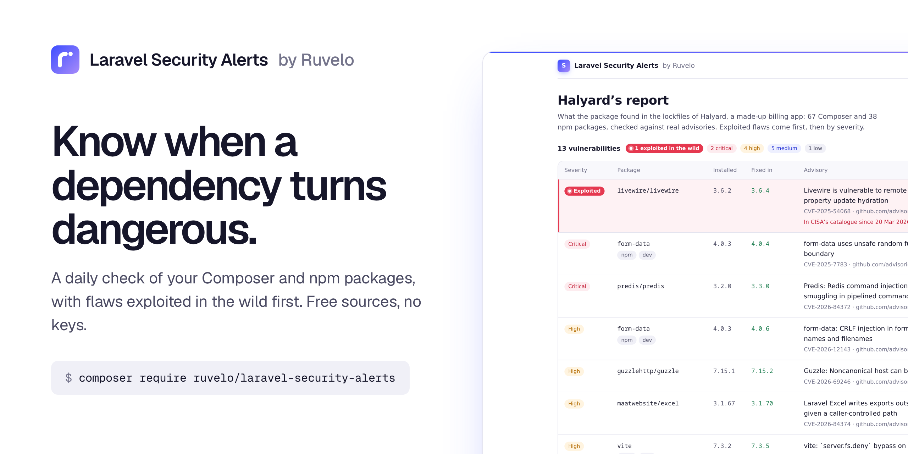
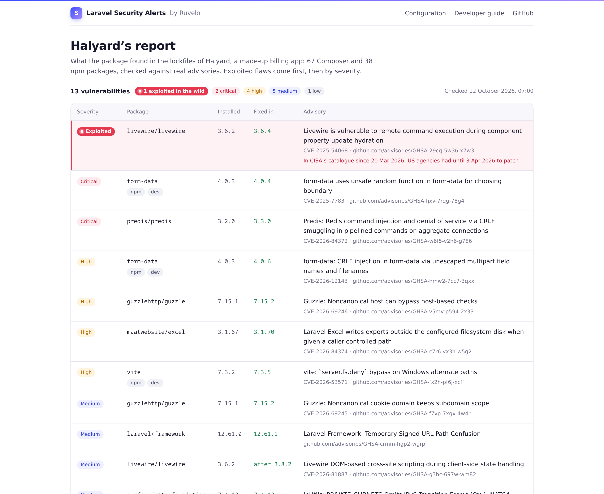
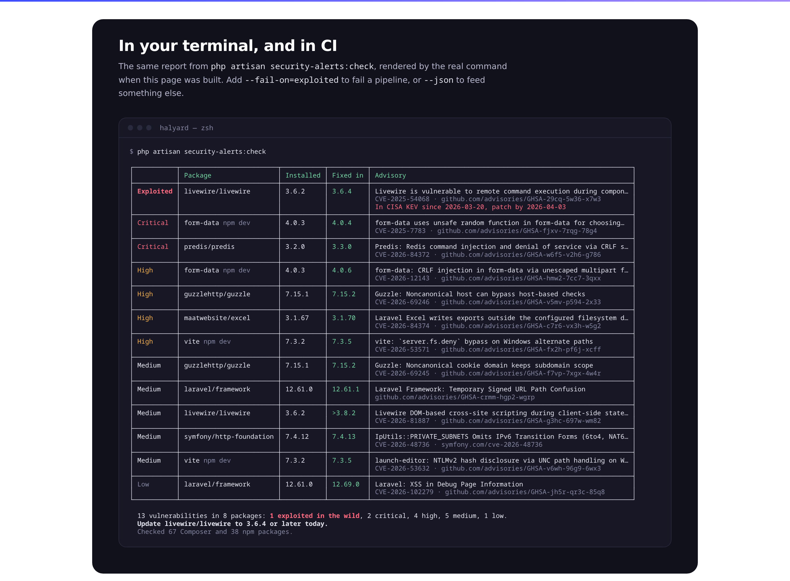
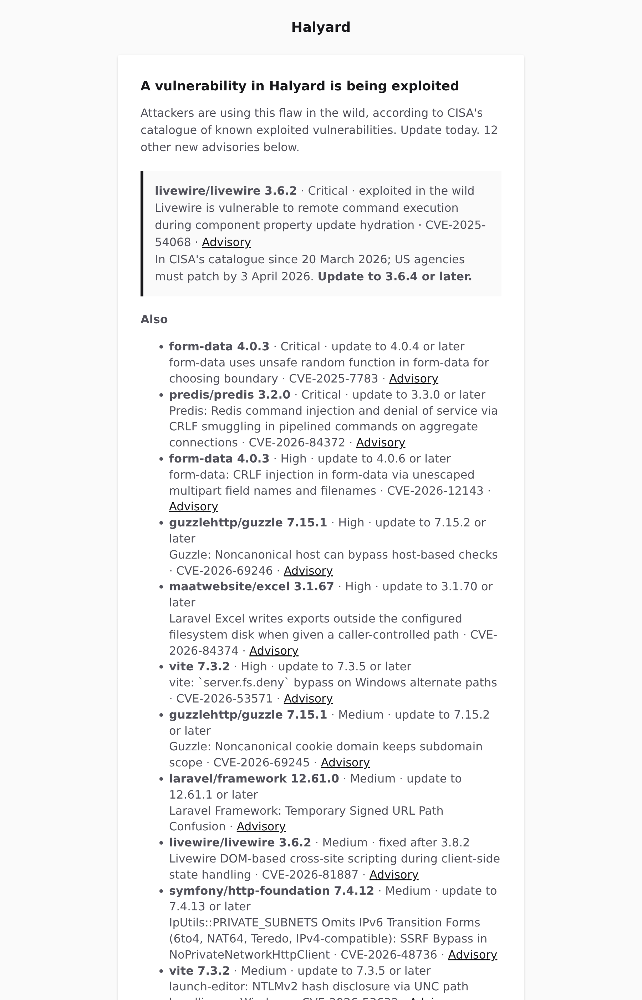
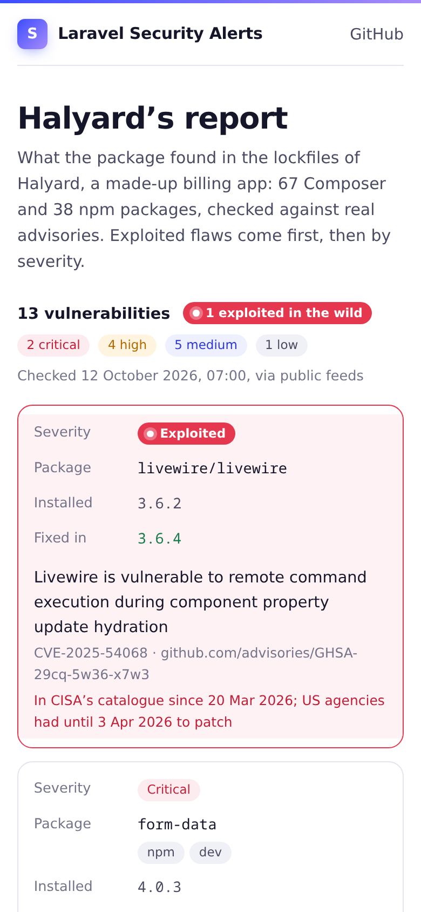

<p align="center">
  <a href="https://ruvelo.github.io/laravel-security-alerts/"></a>
</p>

<p align="center">
  <a href="https://ruvelo.github.io/laravel-security-alerts/"><strong>Live demo</strong></a> &nbsp;&nbsp;&nbsp;
  <a href="#configuration"><strong>Configuration</strong></a> &nbsp;&nbsp;&nbsp;
  <a href="#for-developers"><strong>Developer guide</strong></a> &nbsp;&nbsp;&nbsp;
  <a href="CHANGELOG.md"><strong>Changelog</strong></a>
</p>

<p align="center">
  <a href="https://github.com/Ruvelo/laravel-security-alerts/actions/workflows/tests.yml"></a>
  
  
  
  <a href="LICENSE"></a>
</p>

# Laravel Security Alerts

**Know when a dependency turns dangerous.** `composer audit` only runs when someone types it. This package checks the exact Composer and npm versions your app runs every day, tells you once when one becomes vulnerable, and again when attackers start exploiting it in the wild.

```
composer require ruvelo/laravel-security-alerts
php artisan migrate
echo "SECURITY_ALERTS_MAIL=you@example.com" >> .env
```

That's all: the daily check schedules itself. Try `php artisan security-alerts:check` now, or see what it found in a made-up app in the [live demo](https://ruvelo.github.io/laravel-security-alerts/).

## A quick tour



**Exploited now, patch today.** Advisories are matched against CISA's catalogue of [known exploited vulnerabilities](https://www.cisa.gov/known-exploited-vulnerabilities-catalog). A flaw that attackers are using goes to the top, whatever its score, with the day CISA listed it and the version that fixes it.



**In your terminal and in CI.** `php artisan security-alerts:check` prints the same report. `--fail-on=exploited` fails a pipeline, `--json` feeds anything else.

<table>
  <tr>
    <td width="50%"></td>
    <td width="50%"></td>
  </tr>
  <tr>
    <td>One email for everything new, <strong>exploited first</strong>, through your own mailer. Never the same alert twice.</td>
    <td>The demo is <strong>rendered by the package</strong> from real advisories, light, dark and at phone width.</td>
  </tr>
</table>

## Features

- **Composer and npm**: exact versions from `composer.lock` and, if you have one, `package-lock.json` (lockfile versions 1 to 3). Missing files are fine.
- **Exploited in the wild first**: CVEs in CISA's KEV catalogue are marked, with the date added and the due date, and ranked above everything else.
- **What to update to**: the fixed version is worked out from the advisory's ranges with `composer/semver`, including ranges split by minor version. When an advisory only names the last affected release, it says so (`>2.10.1`).
- **Quiet**: each finding is sent once, and once more if it becomes exploited. Fixed ones are closed when the package is updated. A failed feed never closes anything, and a `cache:clear` never re-sends.
- **Mail, Slack and your own notifiables**, plus events (`VulnerabilityFound`, `VulnerabilityExploited`, `VulnerabilityResolved`) to hook anything else.
- **Scheduled for you**: a daily check at 07:00, an optional weekly digest.
- **CI-ready command**: `--fail-on=exploited|critical|high|medium|any`, `--json`, exit code 2 when it couldn't check everything.
- **Free sources, no keys**: Packagist, OSV.dev and CISA. Only package names and versions leave your server, as with `composer audit`.
- **Optional extras**: a [Laravel Pulse](https://pulse.laravel.com) card, a [spatie/laravel-health](https://github.com/spatie/laravel-health) check, an MCP tool for AI agents and [Laravel Boost](https://laravel.com/docs/boost) guidelines. None is required.

Watching many sites? [Valtry](https://valtry.co.uk/?utm_source=ruvelo&utm_medium=github&utm_campaign=laravel-security-alerts) scans them from the outside.

## Requirements

- PHP 8.3+
- Laravel 12 or 13, with the [scheduler](https://laravel.com/docs/scheduling#running-the-scheduler) running
- For Slack: `composer require laravel/slack-notification-channel` (3.6 or later)

## Where it looks, and what it sends

| Source | For | What leaves your server |
|---|---|---|
| [Packagist security advisories](https://packagist.org/apidoc#list-security-advisories) | Composer packages. It's the API `composer audit` uses, fed by the GitHub Advisory Database and FriendsOfPHP | Package names, in a POST of up to 200 at a time |
| [OSV.dev](https://osv.dev) | npm packages from `package-lock.json` | Package names and versions; then each matching advisory is fetched by its ID |
| [CISA KEV](https://www.cisa.gov/known-exploited-vulnerabilities-catalog) | Which CVEs are being exploited | Nothing: the catalogue is downloaded whole |

Nothing about your app is sent: no URL, no environment, no code. Requests identify themselves as `ruvelo/laravel-security-alerts`. Answers are cached (an hour for advisories, six hours for the catalogue), so running the command twice is instant; `--fresh` skips the cache. Use a mirror or Private Packagist by changing `sources.packagist.url`.

## The command

```
php artisan security-alerts:check
```

| Option | |
|---|---|
| `--fail-on=exploited` | Exit with 1 when a finding is at least this bad: `exploited`, `critical`, `high`, `medium` or `any`. Exploited findings count at every level |
| `--json` | Print the report as JSON |
| `--notify` | Remember findings and send alerts for new ones. This is what the scheduler runs; without it, the command changes nothing |
| `--fresh` | Ignore cached feeds |

Exit codes: `0` fine, `1` a finding reached `--fail-on`, `2` a lockfile or feed couldn't be read, so the answer is incomplete.

In GitHub Actions, after `composer install`:

```yaml
- run: php artisan security-alerts:check --fail-on=exploited
```

## How it remembers

What it has seen lives in one small table, `security_alerts` (the migration loads automatically). A table rather than the cache, because deploys often run `cache:clear`, and a cleared cache would send every old alert again. It also gives each finding a history: when it was first seen, when it was sent, when it became exploited, when it was fixed.

A finding is one advisory on one package. It's **new** the first time a check sees it, or if it comes back after being fixed. It's **exploited** the first time the check sees its CVE in CISA's catalogue. It's **resolved** when a complete check of its ecosystem no longer finds it. Alerts that couldn't be sent (no one configured yet, mail down) wait for the next check.

## Configuration

Everything works without configuration. To change the defaults:

```
php artisan vendor:publish --tag=security-alerts-config
```

| Key | Default | |
|---|---|---|
| `notify.mail` | `[]` (`SECURITY_ALERTS_MAIL`, comma-separated) | Who gets the email |
| `notify.slack` | `null` (`SECURITY_ALERTS_SLACK_WEBHOOK`) | An incoming webhook URL |
| `notify.via` | `['mail']` | Channels for the notifiables you register with `SecurityAlerts::notifyUsing()` |
| `notify.min_severity` | `null` (`SECURITY_ALERTS_MIN_SEVERITY`) | Skip new findings below `critical`, `high`, `medium` or `low`. Exploited ones are always sent |
| `schedule.enabled` | `true` (`SECURITY_ALERTS_SCHEDULE`) | Schedule the daily check |
| `schedule.time`, `schedule.timezone` | `07:00` (`SECURITY_ALERTS_TIME`), app timezone | When |
| `digest.enabled` | `false` (`SECURITY_ALERTS_DIGEST`) | A weekly email of everything still open, even when nothing changed |
| `digest.day`, `digest.time` | `monday`, `08:00` | When |
| `composer.lockfile` | `base_path('composer.lock')` | |
| `composer.include_dev` | `false` | Dev packages aren't deployed, so they're left out |
| `npm.enabled` | `true` | Check `package-lock.json` when there is one |
| `npm.lockfile` | `base_path('package-lock.json')` | |
| `npm.include_dev` | `true` | Laravel apps list axios, Alpine and friends as devDependencies because Vite bundles them, so they count |
| `sources.packagist.url`, `sources.osv.url`, `sources.kev.url` | the public feeds | For mirrors |
| `sources.kev.enabled` | `true` | Mark exploited findings |
| `cache.store` | `null` (`SECURITY_ALERTS_CACHE_STORE`) | Your default store when null |
| `cache.advisories_ttl`, `cache.kev_ttl`, `cache.osv_details_ttl` | 1 hour, 6 hours, 1 week | In seconds |
| `http.timeout`, `http.tries` | `15`, `2` | Per request |
| `table` | `security_alerts` | |
| `run_migrations` | `true` | Set to false after `vendor:publish --tag=security-alerts-migrations` to run your own copy |
| `mcp.*` | off | See [MCP](#mcp-for-ai-agents) |

## Customising the look

The email is a standard Laravel Markdown mail, so it uses your app's mail theme. To change its wording or layout:

```
php artisan vendor:publish --tag=security-alerts-views
```

and edit `resources/views/vendor/security-alerts/mail/alerts.blade.php` (the Pulse card's view is next to it). To replace the notification altogether, listen to the events and send your own.

## For developers

### PHP API

```php
use Ruvelo\SecurityAlerts\SecurityAlerts;

$report = SecurityAlerts::scan();       // what's vulnerable now; saves and sends nothing
$report->findings;                      // list<Finding>, exploited first, then by severity
$report->exploited();                   // the ones in CISA's catalogue
$report->counts();                      // ['exploited' => 1, 'critical' => 2, 'high' => 4, ...]
$report->isComplete();                  // false if a lockfile or feed failed; see $report->problems

$result = SecurityAlerts::check();      // scan, remember, fire events, send one notification
$result->found;                         // new SecurityAlert models
$result->exploited;                     // newly known to be exploited
$result->resolved;                      // no longer installed

SecurityAlerts::open();                 // open alerts, worst first, from the database: no network
SecurityAlerts::lastCheck();            // ['checked_at' => CarbonImmutable, 'findings' => 13, ...] or null
SecurityAlerts::sendDigest();           // the weekly digest, now

// AppServiceProvider::boot(): also notify your admins, through notify.via
SecurityAlerts::notifyUsing(fn () => User::where('is_admin', true)->get());
```

| `Finding` | Type | |
|---|---|---|
| `package`, `version` | `string` | `livewire/livewire`, `3.6.2` |
| `ecosystem` | `Ecosystem` | `Composer` or `Npm` |
| `advisoryId`, `title`, `link`, `cve` | `string`, `?string` | `PKSA-…` (Packagist) or `GHSA-…` (OSV) |
| `severity` | `Severity` | `Critical`, `High`, `Medium`, `Low`, `Unknown` (older advisories have none) |
| `fixedIn` | `?string` | `3.6.4`, `>2.10.1`, or null when no fix is known |
| `exploited` | `?KevEntry` | `cve`, `name`, `dateAdded`, `dueDate`, `ransomware` |
| `dev` | `bool` | A dev dependency |

`Report` and `Finding` are `JsonSerializable`; `--json` prints exactly that:

```json
{
    "checked_at": "2026-10-12T07:00:00+00:00",
    "clean": false,
    "complete": true,
    "packages": { "composer": 67, "npm": 38 },
    "counts": { "exploited": 1, "critical": 2, "high": 4, "medium": 5, "low": 1 },
    "problems": [],
    "findings": [
        {
            "key": "composer:livewire/livewire:PKSA-g5js-3ypd-k2kr",
            "ecosystem": "composer",
            "package": "livewire/livewire",
            "version": "3.6.2",
            "dev": false,
            "advisory_id": "PKSA-g5js-3ypd-k2kr",
            "title": "Livewire is vulnerable to remote command execution during component property update hydration",
            "severity": "critical",
            "link": "https://github.com/advisories/GHSA-29cq-5w36-x7w3",
            "cve": "CVE-2025-54068",
            "fixed_in": "3.6.4",
            "affected_versions": ">=3.0.0-beta.1,<3.6.4",
            "reported_at": "2025-07-17 20:26:45",
            "exploited": true,
            "kev": { "cve": "CVE-2025-54068", "name": "Laravel Livewire Code Injection Vulnerability", "date_added": "2026-03-20", "due_date": "2026-04-03", "ransomware": false }
        }
    ]
}
```

The `Ruvelo\SecurityAlerts\Models\SecurityAlert` model is the stored finding (scopes `open()`, `exploited()`, `worstFirst()`; `present()` gives the same shape plus `first_seen_at`, `last_seen_at`, `resolved_at`). Only `SecurityAlerts::check()` writes it; writing to it yourself would break "send once".

### Events

| Event | Fires when | Has |
|---|---|---|
| `VulnerabilityFound` | A check sees a finding for the first time, or again after it was fixed | `$alert` |
| `VulnerabilityExploited` | A finding's CVE is in CISA's catalogue for the first time, new or not | `$alert` |
| `VulnerabilityResolved` | A complete check no longer finds it | `$alert` |

```php
Event::listen(VulnerabilityExploited::class, fn ($event) => Incident::open("Patch {$event->alert->package} today"));
```

### Exceptions

All extend `Ruvelo\SecurityAlerts\Exceptions\SecurityAlertsException`: `NotInstalled` (the migration hasn't run), `LockfileUnreadable`, `SourceUnavailable` (with `$source`) and `InvalidThreshold`. `scan()` and `check()` turn lockfile and feed failures into `$report->problems` rather than throwing.

### Laravel Pulse

With [Pulse](https://pulse.laravel.com) installed, add the card to `resources/views/vendor/pulse/dashboard.blade.php`:

```blade
<livewire:security-alerts cols="4" rows="2" />
```

It lists open alerts, exploited first, from the table: it never calls a feed.

### Health checks

With [spatie/laravel-health](https://github.com/spatie/laravel-health):

```php
use Ruvelo\SecurityAlerts\Integrations\Health\SecurityAlertsCheck;

Health::checks([
    SecurityAlertsCheck::new(),                       // fails on exploited, warns from high
    // ->warnFrom('medium')->failFrom('critical')->staleAfterHours(48)
]);
```

It also warns when no check has run for 48 hours, which usually means the scheduler stopped.

### MCP for AI agents

With [`laravel/mcp`](https://laravel.com/docs/mcp) installed and `SECURITY_ALERTS_MCP=true`, agents get a read-only `list_security_alerts` tool (filters: `exploited_only`, `min_severity`) through `php artisan mcp:start security-alerts`. Set `mcp.path` to serve it over HTTP too, behind `mcp.middleware` (`auth:sanctum` by default).

### Laravel Boost

If your app uses [Laravel Boost](https://laravel.com/docs/boost), `php artisan boost:install` picks up this package's guidelines, so your coding agent runs the check after updating dependencies, fixes exploited findings first, and doesn't write to the alerts table or call the feeds itself.

### In your tests

Fake the feeds with `Http::fake()` (URLs under `packagist.org/api/security-advisories/`, `api.osv.dev/v1/` and `www.cisa.gov/`), and use the factory for anything that reads alerts:

```php
use Ruvelo\SecurityAlerts\Models\SecurityAlert;

SecurityAlert::factory()->exploited()->forPackage('livewire/livewire', '3.6.2')->create();
SecurityAlert::factory()->severity(Severity::High)->create();
SecurityAlert::factory()->resolved()->create();
SecurityAlert::factory()->pending()->create();   // not yet sent
```

## Contributing

Pull requests are welcome. Clone, `composer install`, then `composer check` runs code style (Pint), static analysis (PHPStan level 8) and the tests, exactly as CI does. The tests never touch the network: feeds are answered from recorded responses in `tests/fixtures`. See [CONTRIBUTING.md](CONTRIBUTING.md) and the [changelog](CHANGELOG.md).

The demo and screenshots are built from the package itself: `composer demo` writes the static demo into `build/`, and `demo/screenshots.sh` regenerates `art/`.

## Credits

Built by [François Bultez](https://github.com/francoisbultez) at [Valtry](https://valtry.co.uk/?utm_source=ruvelo&utm_medium=github&utm_campaign=laravel-security-alerts), the website security scanner, and everyone who [contributes](https://github.com/Ruvelo/laravel-security-alerts/graphs/contributors).

Advisories come from [Packagist](https://packagist.org) (and through it the [GitHub Advisory Database](https://github.com/advisories) and [FriendsOfPHP/security-advisories](https://github.com/FriendsOfPHP/security-advisories)), [OSV.dev](https://osv.dev) and [CISA](https://www.cisa.gov/known-exploited-vulnerabilities-catalog). Thanks to everyone who maintains them.

## License

MIT. See [LICENSE](LICENSE).
